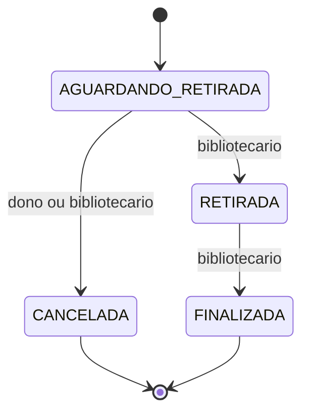

# Contexto técnico — reservas-circulacao

Trechos temáticos do README da main. Confira o código e o README vigente se o contrato tiver mudado.

## Endpoints de reservas

Prefixo público: `/reservas/api/v1`. O leitor vem da claim `sub` do token. O token do leitor é repassado ao Acervo na criação e na consulta de disponibilidade, definido por `ACERVO_BASE_URL`.

| Método e caminho | Perfil | O que faz |
| --- | --- | --- |
| `POST /reservas` (`obraId`, `exemplarId`) | LEITOR | Cria a reserva. 404 se o exemplar não existe na obra, 409 se já está bloqueado, 503 se o Acervo não responde. |
| `GET /reservas/minhas` | LEITOR, BIBLIOTECARIO | Reservas do usuário autenticado (`pagina`, `tamanho`). |
| `GET /reservas?estado=` | BIBLIOTECARIO | Todas as reservas. |
| `GET /reservas/{id}` | dono ou BIBLIOTECARIO | Detalhe. Reserva de outro leitor devolve 404. |
| `POST /reservas/{id}/cancelar` | dono ou BIBLIOTECARIO | Só em `AGUARDANDO_RETIRADA`. |
| `POST /reservas/{id}/retirada` | BIBLIOTECARIO | `AGUARDANDO_RETIRADA` → `RETIRADA`. |
| `POST /reservas/{id}/devolucao` | BIBLIOTECARIO | `RETIRADA` → `FINALIZADA`. |
| `GET /obras/{obraId}/disponibilidade` | LEITOR, BIBLIOTECARIO | Somente as cópias da obra no Acervo que estão livres: `{"obraId":"uuid-da-obra","exemplares":[{"exemplarId":"uuid-do-exemplar","disponivel":true}]}`. 404 se a obra não existe, 503 se o Acervo não responde. |

### Ciclo de circulação

## Nome do solicitante

As respostas de reservas incluem `leitorNome`, além de `leitorId`. Ao criar a reserva, a API extrai o nome das claims `name` ou `given_name`/`family_name` do JWT já validado pelo Spring Security. O cliente envia somente `obraId` e `exemplarId`; nomes ou IDs de leitor enviados no corpo não definem a identidade da reserva. O `sub` continua sendo a referência para propriedade e autorização.

A migration `V2__add_nome_leitor_to_reserva.sql` acrescenta `leitor_nome`, com até 255 caracteres. É um registro do nome no momento da solicitação, preservado nas transições de estado. Alterar o nome no Keycloak não reescreve automaticamente o histórico. Na ausência dessas claims, o nome fica nulo; e-mail e UUID não são usados como nome.

A coluna aceita `null` para preservar reservas anteriores. No deploy desta mudança, os nomes antigos podem ser preenchidos por uma rotina administrativa pontual, restrita aos IDs já presentes nas reservas e ao realm `bibliogest`, após backup. A aplicação em execução não recebe credenciais administrativas nem consulta o banco ou a API administrativa do Keycloak.

As permissões continuam iguais: leitor consulta suas próprias reservas e bibliotecário consulta o balcão. O frontend mostra o nome do solicitante e mantém o ID técnico fora da apresentação. Os testes cobrem nome vindo do token, tentativa de forjá-lo no corpo, Unicode, nome ausente, consulta por outro bibliotecário, persistência no PostgreSQL e migration sobre uma reserva existente.
