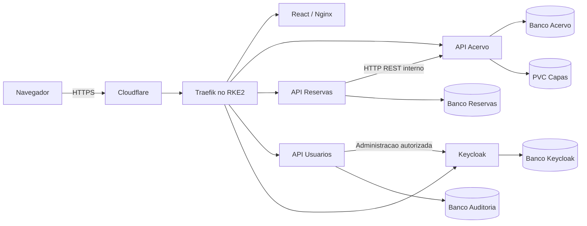

# Contexto técnico — reservas-deploy-docker

Trechos temáticos do README da main. Confira o código e o README vigente se o contrato tiver mudado.

## Arquitetura do BiblioGest

O BiblioGest é uma aplicação de gestão de bibliotecas baseada em microsserviços REST. Cada serviço tem uma responsabilidade e persistência próprias. O Keycloak centraliza identidade e autenticação; a integração entre serviços ocorre por HTTP, sem compartilhar entidades JPA ou consultar diretamente o banco de outro microsserviço.



Os bancos lógicos são independentes, hospedados na instância PostgreSQL do projeto. As capas ficam em volume persistente; o banco de Acervo guarda a referência. O ambiente usa Docker para construção de imagens, containerd e Kubernetes RKE2 para execução, Rancher para gerenciamento, Traefik para roteamento, Nginx para frontend e Cloudflare na borda. GitHub Actions executa validações e build; o deploy é uma operação separada. O pgAdmin é ferramenta de administração do banco, não parte do acesso do leitor.

| Componente | Responsabilidade | Repositório |
| --- | --- | --- |
| Frontend | Catálogo, reservas, balcão e administração | [bibliogest-frontend](https://github.com/ksferreira35/bibliogest-frontend) |
| Acervo | Obras, autores, categorias, exemplares e capas | [bibliogest-acervo](https://github.com/ksferreira35/bibliogest-acervo) |
| Reservas | Disponibilidade e circulação dos exemplares | [bibliogest-reservas](https://github.com/ksferreira35/bibliogest-reservas) |
| Usuários | Administração de contas e auditoria | [bibliogest-usuarios](https://github.com/ksferreira35/bibliogest-usuarios) |

### GitHub Actions

O workflow `.github/workflows/ci.yml` executa:

```text
lint (Checkstyle) → testes + cobertura (clean verify) → empacotamento
```

Os jobs usam `needs`, portanto o empacotamento não começa quando um teste, lint ou limite de cobertura falhar. O último job usa `-DskipTests package`: ele empacota o mesmo código já verificado pelo job anterior, sem tentar validar cobertura em uma máquina sem os dados da execução anterior.

O resumo da execução mostra as porcentagens de linhas e branches. Em **Actions → execução → Artifacts → coverage-and-tests**, baixe o relatório HTML e os resultados JUnit. Os arquivos são publicados também em caso de reprovação e ficam disponíveis por 14 dias. O workflow roda em push para `main`, branches `feature/**` e `fix/**`, além de pull requests para `main`.

Os testes não usam credenciais de produção e não fazem login em contas reais. Os testes de segurança fornecem JWTs simulados ao decoder de teste e verificam roles válidas, ausência de roles e claims malformadas. Somente `LEITOR` e `BIBLIOTECARIO`, com os nomes exatos, recebem permissões da aplicação. O marcador de autenticação Bearer do Spring não equivale a uma role administrativa.

O Cypress fica no [repositório do frontend](https://github.com/ksferreira35/bibliogest-frontend), onde testa os fluxos em navegador e acessibilidade. Nesta API, os testes usam JUnit, MockMvc e testes de integração; não é necessário outro repositório nem um navegador para medir a cobertura Java. Referência: [regra check do JaCoCo](https://www.jacoco.org/jacoco/trunk/doc/check-mojo.html).
