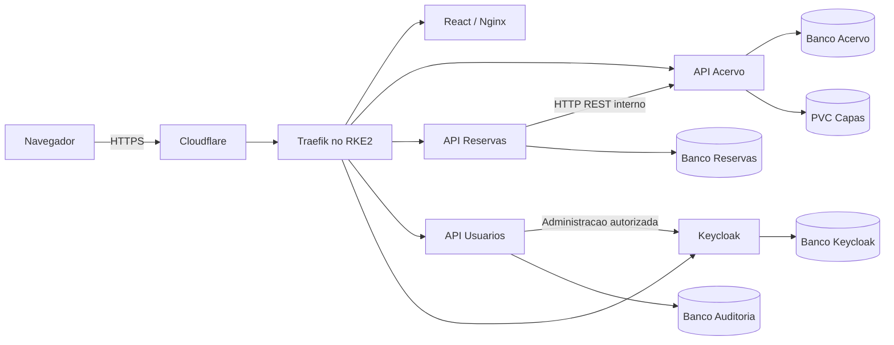

# Contexto técnico — reservas-integracao-acervo

Trechos temáticos do README da main. Confira o código e o README vigente se o contrato tiver mudado.

## Endpoints de reservas

Prefixo público: `/reservas/api/v1`. O leitor vem da claim `sub` do token. O token do leitor é repassado ao Acervo na criação e na consulta de disponibilidade, definido por `ACERVO_BASE_URL`.

| Método e caminho | Perfil | O que faz |
| --- | --- | --- |
| `POST /reservas` (`obraId`, `exemplarId`) | LEITOR | Cria a reserva. 404 se o exemplar não existe na obra, 409 se já está bloqueado, 503 se o Acervo não responde. |
| `GET /reservas/minhas` | LEITOR, BIBLIOTECARIO | Reservas do usuário autenticado (`pagina`, `tamanho`). |
| `GET /reservas?estado=` | BIBLIOTECARIO | Todas as reservas. |
| `GET /reservas/{id}` | dono ou BIBLIOTECARIO | Detalhe. Reserva de outro leitor devolve 404. |
| `POST /reservas/{id}/cancelar` | dono ou BIBLIOTECARIO | Só em `AGUARDANDO_RETIRADA`. |
| `POST /reservas/{id}/retirada` | BIBLIOTECARIO | `AGUARDANDO_RETIRADA` → `RETIRADA`. |
| `POST /reservas/{id}/devolucao` | BIBLIOTECARIO | `RETIRADA` → `FINALIZADA`. |
| `GET /obras/{obraId}/disponibilidade` | LEITOR, BIBLIOTECARIO | Somente as cópias da obra no Acervo que estão livres: `{"obraId":"uuid-da-obra","exemplares":[{"exemplarId":"uuid-do-exemplar","disponivel":true}]}`. 404 se a obra não existe, 503 se o Acervo não responde. |

### SQL Injection e integração

ReservaRepository usa métodos Spring Data JPA e consultas JPQL com parâmetros nomeados, inclusive filtragem por IDs de exemplares e estados. Os dados de entrada não são interpolados em SQL. A API valida JWT com audiência bibliogest-reservas e verifica o dono pelo sub do token.

Para consultar disponibilidade, Reservas busca exemplares do Acervo e desconta os que estão bloqueados por reservas ativas. A integração usa HTTP interno configurado por ambiente; os contratos são testados com provedor simulado. O banco de Reservas continua sendo a fonte da circulação. Manifests compartilhados estão no repositório Acervo.

## Arquitetura do BiblioGest

O BiblioGest é uma aplicação de gestão de bibliotecas baseada em microsserviços REST. Cada serviço tem uma responsabilidade e persistência próprias. O Keycloak centraliza identidade e autenticação; a integração entre serviços ocorre por HTTP, sem compartilhar entidades JPA ou consultar diretamente o banco de outro microsserviço.

Os bancos lógicos são independentes, hospedados na instância PostgreSQL do projeto. As capas ficam em volume persistente; o banco de Acervo guarda a referência. O ambiente usa Docker para construção de imagens, containerd e Kubernetes RKE2 para execução, Rancher para gerenciamento, Traefik para roteamento, Nginx para frontend e Cloudflare na borda. GitHub Actions executa validações e build; o deploy é uma operação separada. O pgAdmin é ferramenta de administração do banco, não parte do acesso do leitor.

| Componente | Responsabilidade | Repositório |
| --- | --- | --- |
| Frontend | Catálogo, reservas, balcão e administração | [bibliogest-frontend](https://github.com/ksferreira35/bibliogest-frontend) |
| Acervo | Obras, autores, categorias, exemplares e capas | [bibliogest-acervo](https://github.com/ksferreira35/bibliogest-acervo) |
| Reservas | Disponibilidade e circulação dos exemplares | [bibliogest-reservas](https://github.com/ksferreira35/bibliogest-reservas) |
| Usuários | Administração de contas e auditoria | [bibliogest-usuarios](https://github.com/ksferreira35/bibliogest-usuarios) |
