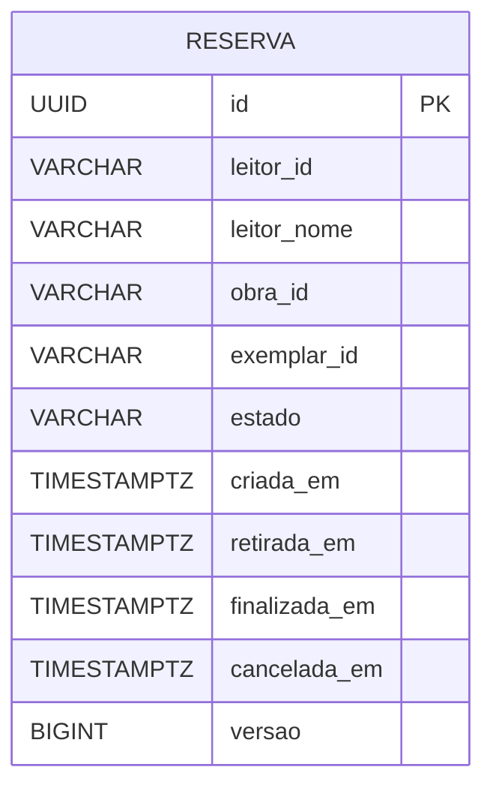

# Contexto técnico — reservas-postgres-flyway

Trechos temáticos do README da main. Confira o código e o README vigente se o contrato tiver mudado.

### Modelo de dados

| Coluna | Tipo e finalidade |
| --- | --- |
| id | UUID, chave primária |
| leitor_id | VARCHAR(64), identificador obrigatório da claim sub |
| leitor_nome | VARCHAR(255), nome opcional registrado no momento da solicitação |
| obra_id, exemplar_id | VARCHAR(64), referências obrigatórias aos recursos do Acervo; sem FK entre bancos independentes |
| estado | VARCHAR(20), obrigatório; CHECK restringe estados válidos |
| criada_em | TIMESTAMPTZ, obrigatório |
| retirada_em, finalizada_em, cancelada_em | TIMESTAMPTZ, opcionais conforme transição |
| versao | BIGINT, obrigatório, padrão 0; controle de concorrência |

O índice único parcial ux_reserva_exemplar_ativa garante no máximo uma reserva ativa por exemplar (AGUARDANDO_RETIRADA ou RETIRADA). Índices por leitor/data e estado/data apoiam consultas. V1 cria tabela e índices; V2 acrescenta leitor_nome sem descartar dados anteriores. Arquivos: [migrations](../../../../src/main/resources/db/migration).

### SQL Injection e integração

ReservaRepository usa métodos Spring Data JPA e consultas JPQL com parâmetros nomeados, inclusive filtragem por IDs de exemplares e estados. Os dados de entrada não são interpolados em SQL. A API valida JWT com audiência bibliogest-reservas e verifica o dono pelo sub do token.

Para consultar disponibilidade, Reservas busca exemplares do Acervo e desconta os que estão bloqueados por reservas ativas. A integração usa HTTP interno configurado por ambiente; os contratos são testados com provedor simulado. O banco de Reservas continua sendo a fonte da circulação. Manifests compartilhados estão no repositório Acervo.
