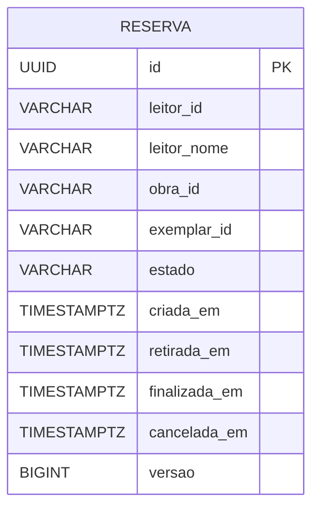
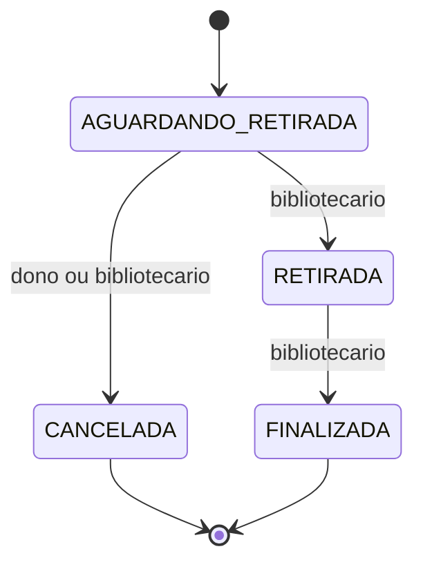

# Contexto técnico — reservas-spring-boot

Trechos temáticos do README da main. Confira o código e o README vigente se o contrato tiver mudado.

## Endpoints de reservas

Prefixo público: `/reservas/api/v1`. O leitor vem da claim `sub` do token. O token do leitor é repassado ao Acervo na criação e na consulta de disponibilidade, definido por `ACERVO_BASE_URL`.

| Método e caminho | Perfil | O que faz |
| --- | --- | --- |
| `POST /reservas` (`obraId`, `exemplarId`) | LEITOR | Cria a reserva. 404 se o exemplar não existe na obra, 409 se já está bloqueado, 503 se o Acervo não responde. |
| `GET /reservas/minhas` | LEITOR, BIBLIOTECARIO | Reservas do usuário autenticado (`pagina`, `tamanho`). |
| `GET /reservas?estado=` | BIBLIOTECARIO | Todas as reservas. |
| `GET /reservas/{id}` | dono ou BIBLIOTECARIO | Detalhe. Reserva de outro leitor devolve 404. |
| `POST /reservas/{id}/cancelar` | dono ou BIBLIOTECARIO | Só em `AGUARDANDO_RETIRADA`. |
| `POST /reservas/{id}/retirada` | BIBLIOTECARIO | `AGUARDANDO_RETIRADA` → `RETIRADA`. |
| `POST /reservas/{id}/devolucao` | BIBLIOTECARIO | `RETIRADA` → `FINALIZADA`. |
| `GET /obras/{obraId}/disponibilidade` | LEITOR, BIBLIOTECARIO | Somente as cópias da obra no Acervo que estão livres: `{"obraId":"uuid-da-obra","exemplares":[{"exemplarId":"uuid-do-exemplar","disponivel":true}]}`. 404 se a obra não existe, 503 se o Acervo não responde. |

## Organização interna e persistência

Java 21, Spring Boot, Spring Security, Spring Data JPA, PostgreSQL, Flyway. ReservaController e DisponibilidadeController entregam os contratos REST; ReservaService aplica regras, ReservaRepository persiste as reservas; HttpAcervoClient integra com o catálogo. O banco não duplica obras, exemplares ou contas do Keycloak.

### Modelo de dados

| Coluna | Tipo e finalidade |
| --- | --- |
| id | UUID, chave primária |
| leitor_id | VARCHAR(64), identificador obrigatório da claim sub |
| leitor_nome | VARCHAR(255), nome opcional registrado no momento da solicitação |
| obra_id, exemplar_id | VARCHAR(64), referências obrigatórias aos recursos do Acervo; sem FK entre bancos independentes |
| estado | VARCHAR(20), obrigatório; CHECK restringe estados válidos |
| criada_em | TIMESTAMPTZ, obrigatório |
| retirada_em, finalizada_em, cancelada_em | TIMESTAMPTZ, opcionais conforme transição |
| versao | BIGINT, obrigatório, padrão 0; controle de concorrência |

O índice único parcial ux_reserva_exemplar_ativa garante no máximo uma reserva ativa por exemplar (AGUARDANDO_RETIRADA ou RETIRADA). Índices por leitor/data e estado/data apoiam consultas. V1 cria tabela e índices; V2 acrescenta leitor_nome sem descartar dados anteriores. Arquivos: [migrations](../../../../src/main/resources/db/migration).

### Ciclo de circulação

### SQL Injection e integração

ReservaRepository usa métodos Spring Data JPA e consultas JPQL com parâmetros nomeados, inclusive filtragem por IDs de exemplares e estados. Os dados de entrada não são interpolados em SQL. A API valida JWT com audiência bibliogest-reservas e verifica o dono pelo sub do token.

Para consultar disponibilidade, Reservas busca exemplares do Acervo e desconta os que estão bloqueados por reservas ativas. A integração usa HTTP interno configurado por ambiente; os contratos são testados com provedor simulado. O banco de Reservas continua sendo a fonte da circulação. Manifests compartilhados estão no repositório Acervo.
