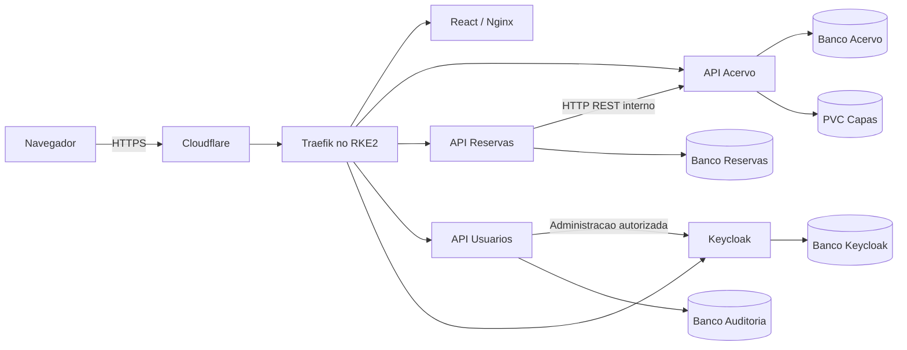
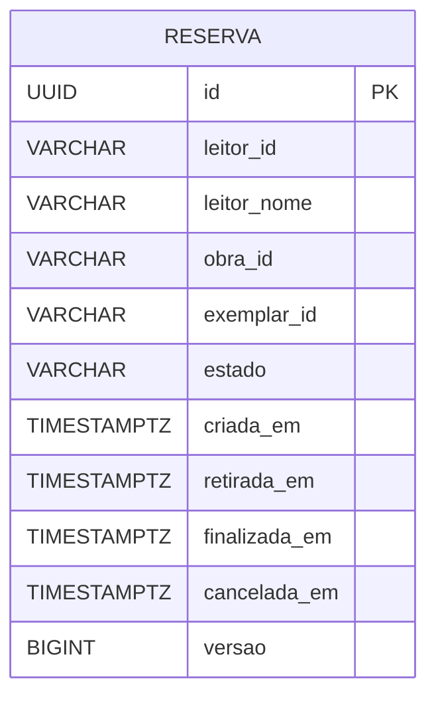
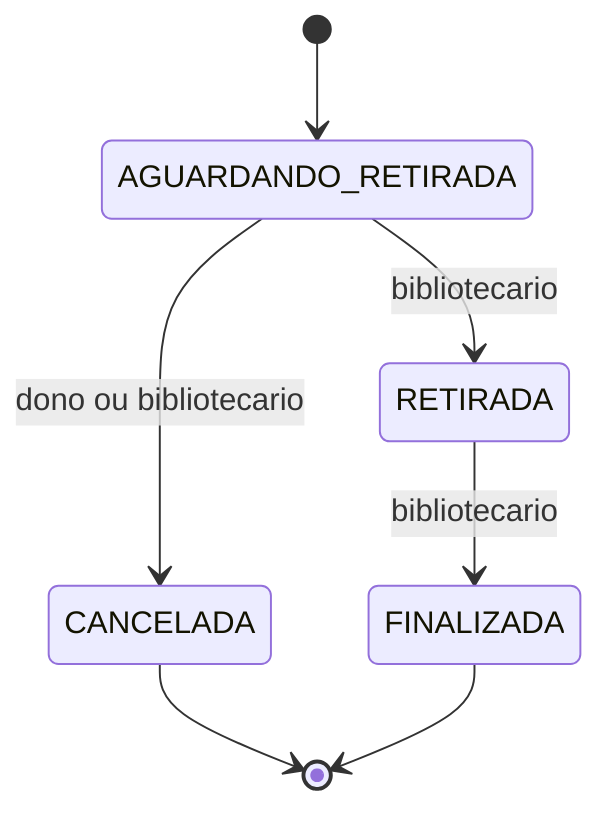

# BiblioGest — Reservas

## Rodar no computador

Use Java 21 e Docker. Copie `.env.example` para `.env` e coloque uma senha de desenvolvimento em `DB_PASSWORD`. O arquivo local é ignorado pelo Git.

Na raiz do repositório, suba o PostgreSQL de Reservas uma vez. O comando usa a mesma senha do `.env`.

```bash
POSTGRES_PASSWORD="$(sed -n 's/^DB_PASSWORD=//p' .env)" docker run -d \
  --name bibliogest-reservas-db \
  -p 127.0.0.1:15433:5432 \
  -v bibliogest-reservas-docker-data:/var/lib/postgresql/data \
  -e POSTGRES_USER=bibliogest_reservas \
  -e POSTGRES_DB=bibliogest_reservas \
  -e POSTGRES_PASSWORD \
  docker.io/library/postgres:17.12-bookworm
```

Se o contêiner já existir e estiver parado, use `docker start bibliogest-reservas-db`.

No IntelliJ, abra o projeto pelo `pom.xml` com o JDK 21. Na configuração de execução de `ReservasApiApplication`, selecione `.env` no campo **Environment variables** e inicie a API.

- [Saúde da API e do banco](http://localhost:8081/reservas/actuator/health/readiness)
- [Swagger de Reservas](http://localhost:8081/reservas/swagger-ui/index.html)

No Swagger, use **Authorize** com o `access_token` da sua própria conta de teste do BiblioGest. Para rodar os testes automatizados, use `mvn verify`. Os testes com PostgreSQL real (`ReservaBancoTest`) sobem um contêiner pelo Testcontainers, então o Docker precisa estar rodando.

Para consultar o Acervo publicado durante o desenvolvimento, o `.env.example` define `ACERVO_BASE_URL=https://bibliogest.ksferreira.org/acervo`. No RKE2, o Deployment usa o Service interno `http://acervo:8080/acervo`.

O CI executa os testes antes do empacotamento. O Dockerfile gera o pacote com `-DskipTests`, pois o teste de banco depende do Docker disponível no ambiente de testes.

## Endpoints de reservas

Prefixo público: `/reservas/api/v1`. O leitor vem da claim `sub` do token. O token do leitor é repassado ao Acervo na criação e na consulta de disponibilidade, definido por `ACERVO_BASE_URL`.

| Método e caminho | Perfil | O que faz |
| --- | --- | --- |
| `POST /reservas` (`obraId`, `exemplarId`) | LEITOR | Cria a reserva. 404 se o exemplar não existe na obra, 409 se já está bloqueado, 503 se o Acervo não responde. |
| `GET /reservas/minhas` | LEITOR, BIBLIOTECARIO | Reservas do usuário autenticado (`pagina`, `tamanho`). |
| `GET /reservas?estado=` | BIBLIOTECARIO | Todas as reservas. |
| `GET /reservas/{id}` | dono ou BIBLIOTECARIO | Detalhe. Reserva de outro leitor devolve 404. |
| `POST /reservas/{id}/cancelar` | dono ou BIBLIOTECARIO | Só em `AGUARDANDO_RETIRADA`. |
| `POST /reservas/{id}/retirada` | BIBLIOTECARIO | `AGUARDANDO_RETIRADA` → `RETIRADA`. |
| `POST /reservas/{id}/devolucao` | BIBLIOTECARIO | `RETIRADA` → `FINALIZADA`. |
| `GET /obras/{obraId}/disponibilidade` | LEITOR, BIBLIOTECARIO | Somente as cópias da obra no Acervo que estão livres: `{"obraId":"uuid-da-obra","exemplares":[{"exemplarId":"uuid-do-exemplar","disponivel":true}]}`. 404 se a obra não existe, 503 se o Acervo não responde. |


## Qualidade e cobertura obrigatória

A configuração de cobertura fica no `pom.xml`, com **JaCoCo 0.8.16**. Para rodar a mesma verificação usada no CI, use Java 21:

```bash
./mvnw --batch-mode --no-transfer-progress clean verify
```

A fase `validate` verifica Checkstyle; a fase `test` executa JUnit; `verify` gera o relatório JaCoCo e reprova o build se a cobertura global ficar abaixo de **80% de linhas ou 80% de branches**. Todos os testes também precisam passar. Não basta executar `mvn test` para validar o limite, porque a regra é cobrada em `verify`.

| Arquivo gerado | Uso |
| --- | --- |
| `target/site/jacoco/index.html` | Relatório navegável por pacote, classe e linha |
| `target/site/jacoco/jacoco.xml` | Totais e integração com analisadores |
| `target/jacoco.exec` | Dados de execução coletados pelo agente |
| `target/surefire-reports/` | Resultados de cada teste JUnit |

O JaCoCo mede todas as classes compiladas da aplicação; não há exclusão de services, controllers, DTOs ou configuração de segurança para aumentar a cobertura. `target/` é ignorado pelo Git e não vai para o repositório. A cobertura mede execução de código, não garante ausência de bugs; os testes verificam resultados e erros esperados.

### GitHub Actions

O workflow `.github/workflows/ci.yml` executa:

```text
lint (Checkstyle) → testes + cobertura (clean verify) → empacotamento
```

Os jobs usam `needs`, portanto o empacotamento não começa quando um teste, lint ou limite de cobertura falhar. O último job usa `-DskipTests package`: ele empacota o mesmo código já verificado pelo job anterior, sem tentar validar cobertura em uma máquina sem os dados da execução anterior.

O resumo da execução mostra as porcentagens de linhas e branches. Em **Actions → execução → Artifacts → coverage-and-tests**, baixe o relatório HTML e os resultados JUnit. Os arquivos são publicados também em caso de reprovação e ficam disponíveis por 14 dias. O workflow roda em push para `main`, branches `feature/**` e `fix/**`, além de pull requests para `main`.

Os testes não usam credenciais de produção e não fazem login em contas reais. Os testes de segurança fornecem JWTs simulados ao decoder de teste e verificam roles válidas, ausência de roles e claims malformadas. Somente `LEITOR` e `BIBLIOTECARIO`, com os nomes exatos, recebem permissões da aplicação. O marcador de autenticação Bearer do Spring não equivale a uma role administrativa.

O Cypress fica no [repositório do frontend](https://github.com/ksferreira35/bibliogest-frontend), onde testa os fluxos em navegador e acessibilidade. Nesta API, os testes usam JUnit, MockMvc e testes de integração; não é necessário outro repositório nem um navegador para medir a cobertura Java. Referência: [regra check do JaCoCo](https://www.jacoco.org/jacoco/trunk/doc/check-mojo.html).

### Segurança e integração com o navegador

O backend valida o token Bearer e aplica as permissões do Spring Security; as regras do frontend não substituem essa validação. Os dados privados continuam em variáveis locais ou Secrets do Kubernetes. `.env` e credenciais reais não devem ser incluídos em commits nem imagens; `.env.example` documenta somente as configurações de desenvolvimento.

O frontend e esta API usam a mesma origem em produção, com caminhos separados no Ingress. Não foi adicionada uma liberação genérica de CORS. Para desenvolvimento, use o proxy do Vite no frontend. Caso a API seja servida em outra origem no futuro, configure apenas as origens autorizadas, mantendo a validação de tokens.

A CSP é entregue pelo Nginx do frontend, junto do documento HTML. Esta API retorna JSON e não injeta a interface nem os controles de acessibilidade. Os READMEs do frontend detalham a política e a auditoria WCAG com Cypress/axe.

### Cenários de teste de Reservas

As suítes verificam criação, cancelamento pelo dono/bibliotecário, proibição de acessar reservas de outra pessoa, retirada/devolução, estados inválidos e disponibilidade. Os testes do cliente HTTP simulam o Acervo em um servidor local e conferem o repasse do Bearer e o tratamento de respostas inválidas ou indisponíveis.

`ReservaBancoTest` usa PostgreSQL real em contêiner via Testcontainers para verificar as restrições de reservas ativas e concorrência. O Docker precisa estar disponível para a suíte completa, inclusive no CI. Não use a base de produção para esses testes. Os demais testes usam mocks ou configurações isoladas.

## Nome do solicitante

As respostas de reservas incluem `leitorNome`, além de `leitorId`. Ao criar a reserva, a API extrai o nome das claims `name` ou `given_name`/`family_name` do JWT já validado pelo Spring Security. O cliente envia somente `obraId` e `exemplarId`; nomes ou IDs de leitor enviados no corpo não definem a identidade da reserva. O `sub` continua sendo a referência para propriedade e autorização.

A migration `V2__add_nome_leitor_to_reserva.sql` acrescenta `leitor_nome`, com até 255 caracteres. É um registro do nome no momento da solicitação, preservado nas transições de estado. Alterar o nome no Keycloak não reescreve automaticamente o histórico. Na ausência dessas claims, o nome fica nulo; e-mail e UUID não são usados como nome.

A coluna aceita `null` para preservar reservas anteriores. No deploy desta mudança, os nomes antigos podem ser preenchidos por uma rotina administrativa pontual, restrita aos IDs já presentes nas reservas e ao realm `bibliogest`, após backup. A aplicação em execução não recebe credenciais administrativas nem consulta o banco ou a API administrativa do Keycloak.

As permissões continuam iguais: leitor consulta suas próprias reservas e bibliotecário consulta o balcão. O frontend mostra o nome do solicitante e mantém o ID técnico fora da apresentação. Os testes cobrem nome vindo do token, tentativa de forjá-lo no corpo, Unicode, nome ausente, consulta por outro bibliotecário, persistência no PostgreSQL e migration sobre uma reserva existente.

## Arquitetura do BiblioGest

O BiblioGest é uma aplicação de gestão de bibliotecas baseada em microsserviços REST. Cada serviço tem uma responsabilidade e persistência próprias. O Keycloak centraliza identidade e autenticação; a integração entre serviços ocorre por HTTP, sem compartilhar entidades JPA ou consultar diretamente o banco de outro microsserviço.



Os bancos lógicos são independentes, hospedados na instância PostgreSQL do projeto. As capas ficam em volume persistente; o banco de Acervo guarda a referência. O ambiente usa Docker para construção de imagens, containerd e Kubernetes RKE2 para execução, Rancher para gerenciamento, Traefik para roteamento, Nginx para frontend e Cloudflare na borda. GitHub Actions executa validações e build; o deploy é uma operação separada. O pgAdmin é ferramenta de administração do banco, não parte do acesso do leitor.

| Componente | Responsabilidade | Repositório |
| --- | --- | --- |
| Frontend | Catálogo, reservas, balcão e administração | [bibliogest-frontend](https://github.com/ksferreira35/bibliogest-frontend) |
| Acervo | Obras, autores, categorias, exemplares e capas | [bibliogest-acervo](https://github.com/ksferreira35/bibliogest-acervo) |
| Reservas | Disponibilidade e circulação dos exemplares | [bibliogest-reservas](https://github.com/ksferreira35/bibliogest-reservas) |
| Usuários | Administração de contas e auditoria | [bibliogest-usuarios](https://github.com/ksferreira35/bibliogest-usuarios) |

## Organização interna e persistência

Java 21, Spring Boot, Spring Security, Spring Data JPA, PostgreSQL, Flyway. ReservaController e DisponibilidadeController entregam os contratos REST; ReservaService aplica regras, ReservaRepository persiste as reservas; HttpAcervoClient integra com o catálogo. O banco não duplica obras, exemplares ou contas do Keycloak.

### Modelo de dados



| Coluna | Tipo e finalidade |
| --- | --- |
| id | UUID, chave primária |
| leitor_id | VARCHAR(64), identificador obrigatório da claim sub |
| leitor_nome | VARCHAR(255), nome opcional registrado no momento da solicitação |
| obra_id, exemplar_id | VARCHAR(64), referências obrigatórias aos recursos do Acervo; sem FK entre bancos independentes |
| estado | VARCHAR(20), obrigatório; CHECK restringe estados válidos |
| criada_em | TIMESTAMPTZ, obrigatório |
| retirada_em, finalizada_em, cancelada_em | TIMESTAMPTZ, opcionais conforme transição |
| versao | BIGINT, obrigatório, padrão 0; controle de concorrência |

O índice único parcial ux_reserva_exemplar_ativa garante no máximo uma reserva ativa por exemplar (AGUARDANDO_RETIRADA ou RETIRADA). Índices por leitor/data e estado/data apoiam consultas. V1 cria tabela e índices; V2 acrescenta leitor_nome sem descartar dados anteriores. Arquivos: [migrations](src/main/resources/db/migration).

### Ciclo de circulação



### SQL Injection e integração

ReservaRepository usa métodos Spring Data JPA e consultas JPQL com parâmetros nomeados, inclusive filtragem por IDs de exemplares e estados. Os dados de entrada não são interpolados em SQL. A API valida JWT com audiência bibliogest-reservas e verifica o dono pelo sub do token.

Para consultar disponibilidade, Reservas busca exemplares do Acervo e desconta os que estão bloqueados por reservas ativas. A integração usa HTTP interno configurado por ambiente; os contratos são testados com provedor simulado. O banco de Reservas continua sendo a fonte da circulação. Manifests compartilhados estão no repositório Acervo.

## Matriz de permissões

As roles são atribuídas no Keycloak e verificadas nas APIs. Uma conta pode acumular roles; ADMINISTRADOR por si só não equivale a LEITOR ou BIBLIOTECARIO.

| Operação | LEITOR | BIBLIOTECARIO | ADMINISTRADOR |
| --- | --- | --- | --- |
| Consultar catálogo e disponibilidade | Sim | Sim | Se também leitor/bibliotecário |
| Criar reserva pessoal | Sim | Se também leitor | Se também leitor |
| Consultar reservas próprias | Sim | Sim | Se também leitor/bibliotecário |
| Cancelar reserva aguardando retirada | Própria | Sim | Conforme outras roles |
| Consultar balcão, registrar retirada/devolução | Não | Sim | Se também bibliotecário |
| Cadastrar e editar acervo | Não | Sim | Se também bibliotecário |
| Administrar contas e consultar auditoria | Não | Não | Sim |

A ausência de autenticação válida leva a 401; uma role insuficiente leva a 403. Consultas a reservas de terceiros sem autorização devolvem 404 conforme o contrato. IDs técnicos identificam recursos; não substituem autorização.

## Segurança em camadas

| Controle | Implementação e finalidade |
| --- | --- |
| Autenticação | Keycloak, OAuth 2.0/OIDC, PKCE S256 no frontend; tokens JWT Bearer nas APIs. |
| Autorização | Spring Security verifica assinatura, emissor, audiência e expiração; roles e propriedade dos recursos são avaliadas no backend. |
| SQL Injection | Dados de entrada são tratados como valores tipados em consultas parametrizadas nos repositories, não como trechos de SQL. Validação de entrada complementa essa proteção. |
| XSS | React renderiza conteúdo textual com escape; CSP no Nginx limita recursos autorizados no navegador. |
| CSRF | As APIs são stateless e autorizam via Bearer explícito, não por cookie de sessão enviado automaticamente. CSRF do Spring está desativado para esse modelo. Isso não elimina os controles do Keycloak no login. |
| CORS | APIs e frontend usam a mesma origem pública; os caminhos são roteados pelo Ingress. Vite usa proxy no desenvolvimento. Web Origins do Keycloak é configurado no cliente, sem liberação genérica. CORS não substitui autenticação. |
| Clickjacking | Nginx envia X-Frame-Options DENY e CSP frame-ancestors none. |
| Transporte | HTTPS público, HSTS no frontend e Cloudflare na borda. |
| Segredos e rede | Credenciais via ambiente/Secrets, banco e serviços internos com escopo de rede e contas separadas. Swagger fica desabilitado em produção. |

Esses controles reduzem riscos, mas não constituem certificação de ausência de vulnerabilidades. O projeto mantém testes defensivos, validação e revisão dos contratos. Não use produção nem credenciais reais em testes automatizados.

## Skills para agentes de IA
As skills estão em `.agents/skills/`. Cada pasta contém um `SKILL.md` com contexto, regras e orientação de manutenção. São instruções de desenvolvimento para agentes, não funcionalidades de IA em execução no sistema.

| Skill | Finalidade |
| --- | --- |
| [reservas-circulacao](.agents/skills/reservas-circulacao/SKILL.md) | Implementar regras de criação, cancelamento, retirada, devolução e consulta de reservas. |
| [reservas-deploy-docker](.agents/skills/reservas-deploy-docker/SKILL.md) | Preparar imagem de Reservas e integração de deploy com manifests compartilhados do Acervo. |
| [reservas-integracao-acervo](.agents/skills/reservas-integracao-acervo/SKILL.md) | Manter DisponibilidadeController, AcervoClient e HttpAcervoClient, integração HTTP e cálculo de exemplares livres. |
| [reservas-postgres-flyway](.agents/skills/reservas-postgres-flyway/SKILL.md) | Manter persistência PostgreSQL, schema e migrations Flyway da API de reservas. |
| [reservas-seguranca-jwt](.agents/skills/reservas-seguranca-jwt/SKILL.md) | Manter autenticação e autorização defensiva Spring Security/Keycloak na API de reservas. |
| [reservas-spring-boot](.agents/skills/reservas-spring-boot/SKILL.md) | Implementar controllers, DTOs, serviços e tratamento de erros Java/Spring Boot da API de reservas. |
| [reservas-testes-ci](.agents/skills/reservas-testes-ci/SKILL.md) | Validar a API de reservas com JUnit, MockMvc, Mockito, Checkstyle, JaCoCo e GitHub Actions. |
